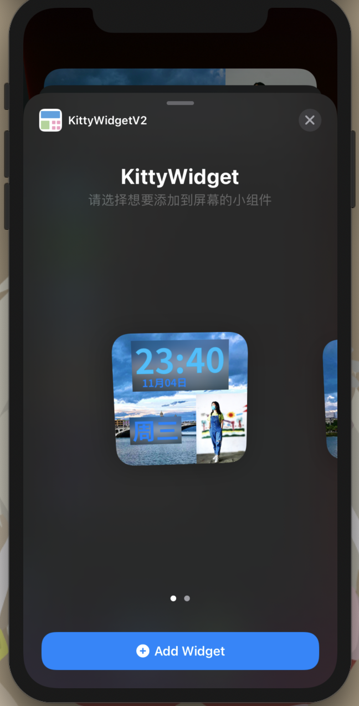
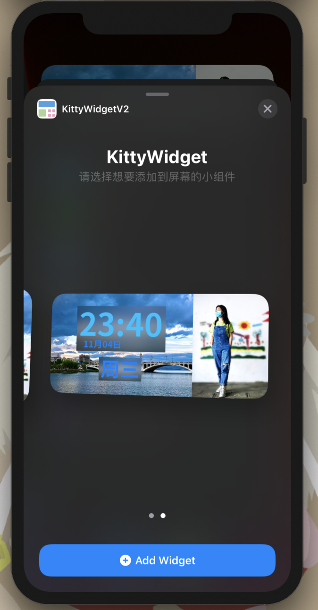
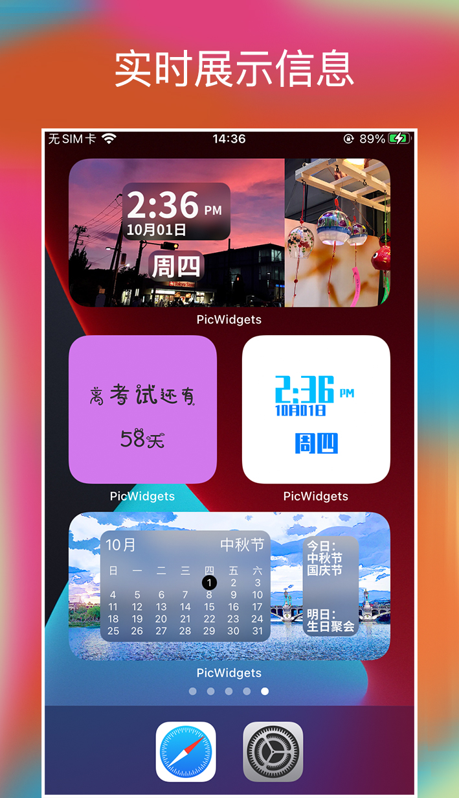
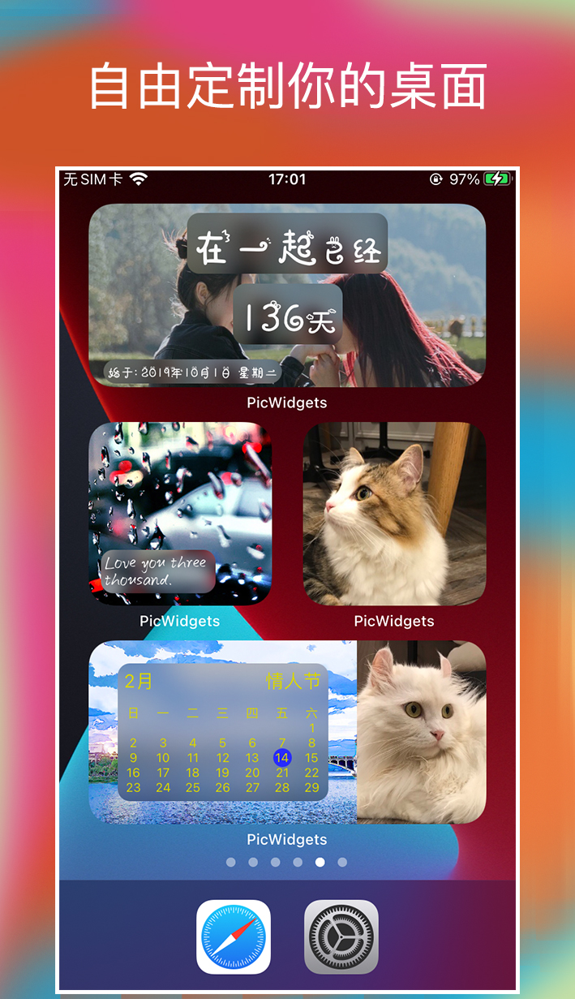
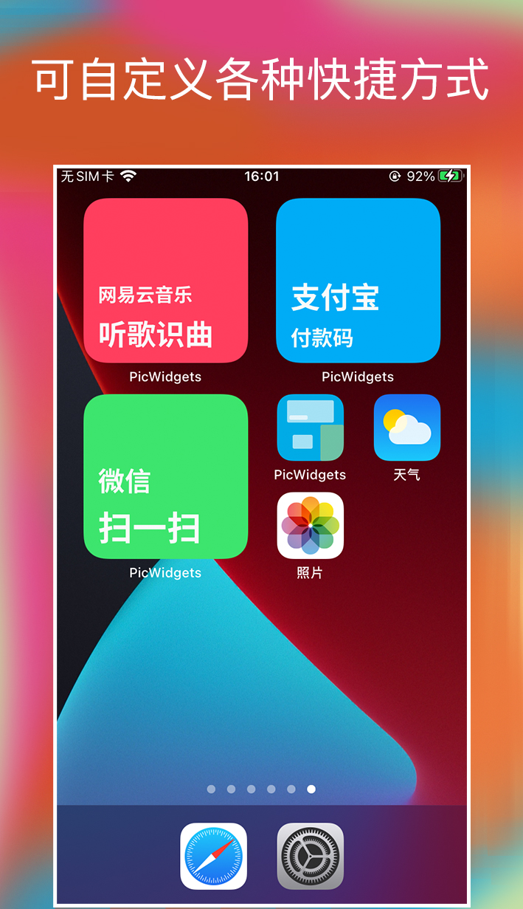
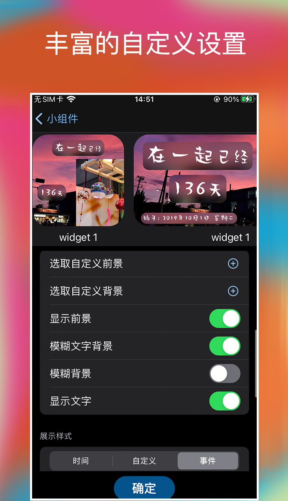
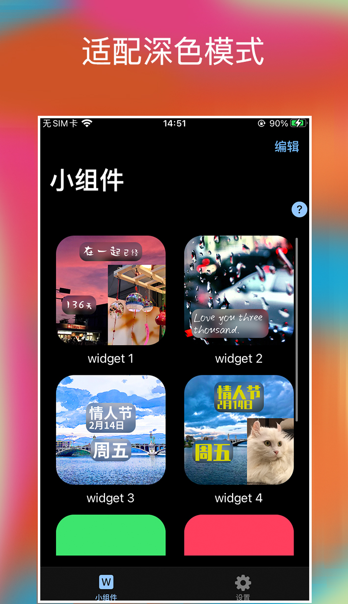

# KittyWidgetV2

### Learn Apple WidgetKit by building a customizable iOS home-screen widget.

KittyWidgetV2 (app name: PicWidgets) is a hands-on Swift project for exploring Apple's early home-screen widget system through a working implementation.

**English** · [简体中文](README.zh-CN.md)

  

## WidgetKit in action

The app provides configurable small and medium home-screen widgets. Each widget can be set up independently in PicWidgets and selected from the iOS widget editor.

<table>
  <tr>
    <td width="50%" align="center" valign="top">
      <strong>Small widget</strong> 
      
    </td>
    <td width="50%" align="center" valign="top">
      <strong>Medium widget</strong> 
      
    </td>
  </tr>
</table>

## Why explore KittyWidgetV2?

This repository is both a study of WidgetKit and a practical implementation. Follow how SwiftUI views, widget configuration, timelines, and shared app data come together in an iOS app.

### Personalize each widget

Choose a background photo or color, add or hide a foreground illustration, and adjust fonts, colors, blur, or custom text. Widgets can be added, renamed, edited, and removed individually.

### Put useful details on the Home Screen

Show the time and date, choose 12-hour or 24-hour time, and optionally display a calendar in the medium widget. The app also offers light, dark, and system appearance settings.

### Connect a widget to an app action

Assign a supported URL scheme to a widget so tapping it can open a chosen action in another app.

### Learn the WidgetKit building blocks

- **Widget configuration:** an intent lets each Home Screen instance select a saved widget design.
- **Timeline rendering:** the WidgetKit extension creates dated entries for the system to display.
- **Shared data:** the app and widget extension exchange saved settings through an App Group.
- **SwiftUI layouts:** small and medium widget families use dedicated views.

<table>
  <tr>
    <td width="33%" align="center" valign="top"></td>
    <td width="33%" align="center" valign="top"></td>
    <td width="33%" align="center" valign="top"></td>
  </tr>
  <tr>
    <td width="50%" align="center" valign="top"></td>
    <td width="50%" align="center" valign="top"></td>
  </tr>
</table>

## Build and run

You need a Mac with Xcode to build and run this iOS project.

1. Clone this repository.
2. Open **KittyWidgetV2.xcodeproj** in Xcode.
3. Select the KittyWidgetV2 app scheme and an iOS simulator. For a physical device, choose your own signing team in Signing & Capabilities.
4. Run the app, then add PicWidgets from the iOS Home Screen widget gallery.

The project uses iOS 14-era WidgetKit APIs. Deployment settings are configured for iOS 14.x across its targets.

## Project map

- **KittyWidgetV2/ContentView.swift** — app tabs and widget collection management.
- **KittyWidgetV2/SmallSetting.swift** — per-widget customization.
- **kittyWidgetExtension/kittyWidgetExtension.swift** — WidgetKit configuration and timeline provider.
- **Models/MyData.swift** — widget models and shared persistence.

## Notes

KittyWidgetV2 is a learning and research project focused on the original iOS 14-era WidgetKit experience. WidgetKit has evolved since then, so check Apple's current documentation before applying these patterns to a new app. The in-app interface currently uses Chinese labels; this README is available in English and Simplified Chinese.

If this project helps you understand WidgetKit, consider giving it a star.

## Resources

- [Apple WidgetKit documentation](https://developer.apple.com/documentation/widgetkit)
- [SwiftUI documentation](https://developer.apple.com/documentation/swiftui)
