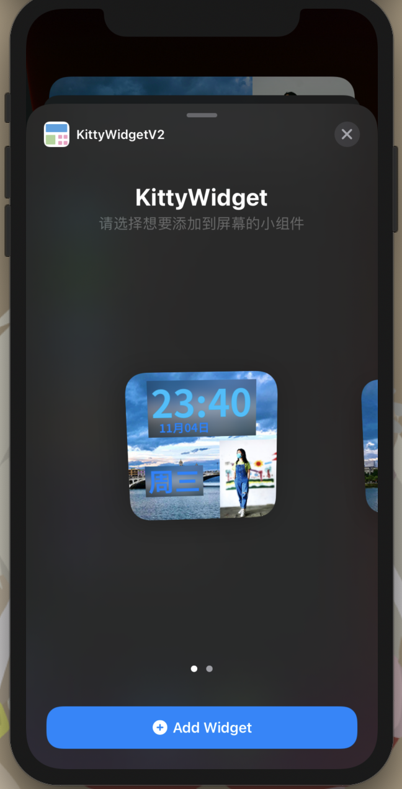
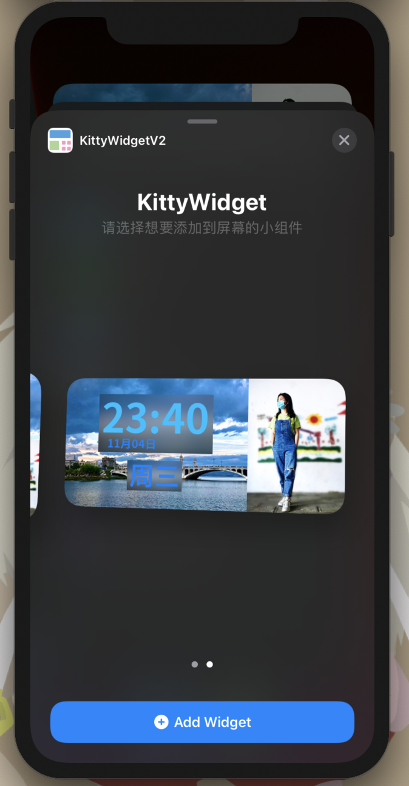
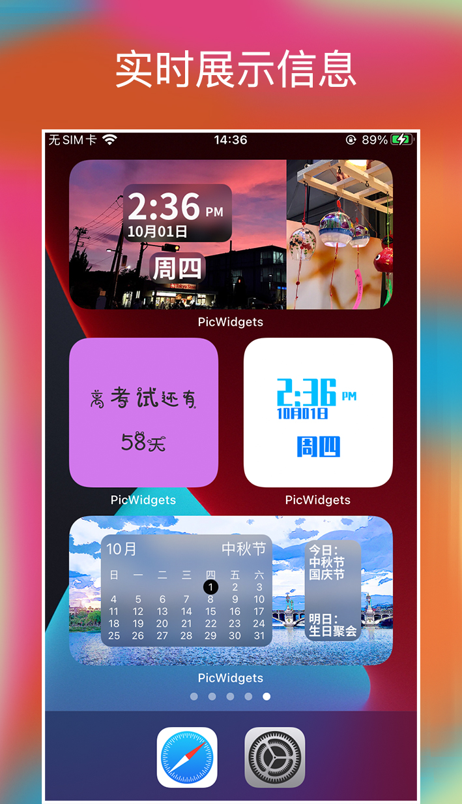
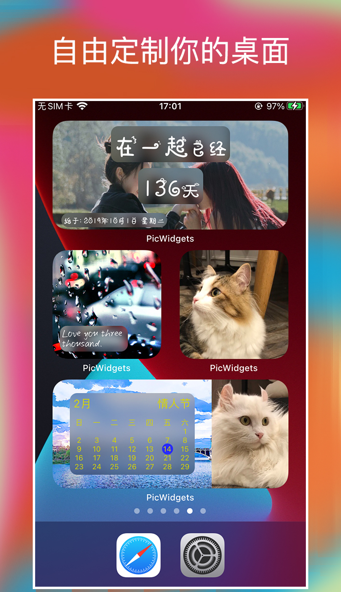
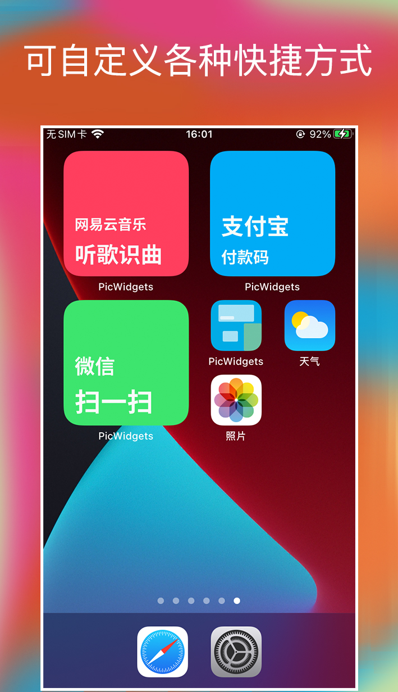
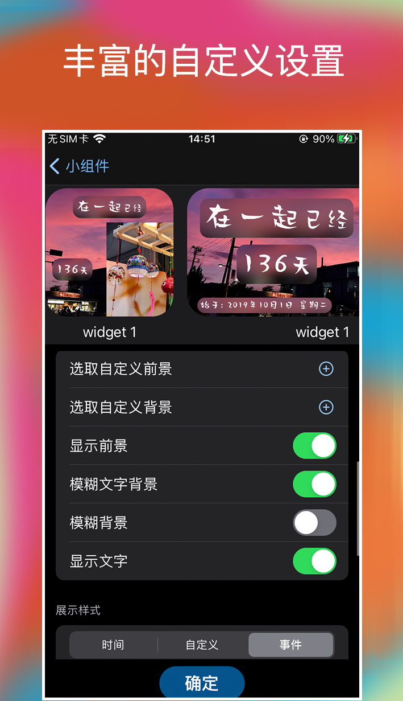
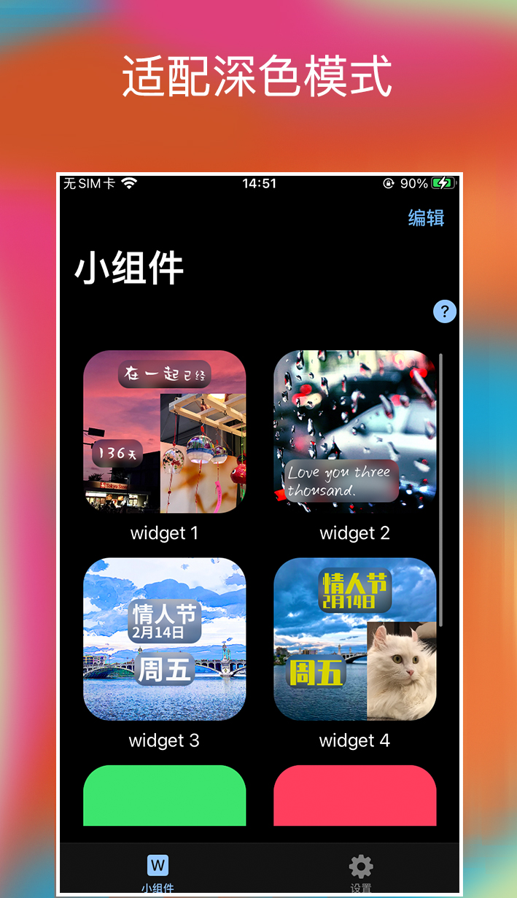

# KittyWidgetV2

### 通过实际实现，学习 Apple WidgetKit 与 iOS 主屏幕小组件。

KittyWidgetV2（应用名称：PicWidgets）是一个 Swift 学习研究项目，通过一款可运行的应用，探索 Apple 早期主屏幕小组件的设计与实现。

[English](README.md) · **简体中文**

  

## WidgetKit 实际效果

应用提供可配置的小号和中号主屏幕组件。每个组件都可以在 PicWidgets 中单独设置，再通过 iOS 的小组件编辑界面选择。

<table>
  <tr>
    <td width="50%" align="center" valign="top">
      <strong>小号组件</strong> 
      
    </td>
    <td width="50%" align="center" valign="top">
      <strong>中号组件</strong> 
      
    </td>
  </tr>
</table>

## KittyWidgetV2 值得探索的内容

这个仓库既是对 WidgetKit 的学习研究，也是一个可运行的实现示例。你可以跟着代码了解 SwiftUI 视图、小组件配置、时间线和应用间共享数据如何组合起来。

### 为每个组件单独定制

选择照片或纯色背景，添加或隐藏前景插画，并调整字体、颜色、模糊效果或自定义文字。组件实例可以分别新增、重命名、编辑和删除。

### 在主屏幕显示实用信息

显示时间和日期，可选择 12 小时制或 24 小时制；中号组件还可以显示日历。应用提供浅色、深色和跟随系统的外观选项。

### 点按组件打开应用操作

为组件指定受支持的 URL Scheme，点按主屏幕上的组件即可跳转到其他应用中对应的操作。

### 学习 WidgetKit 的关键组成

- **小组件配置：** 使用 Intent 让主屏幕上的每个组件实例选择已保存的样式。
- **时间线渲染：** WidgetKit 扩展生成带日期的条目，交由系统展示。
- **共享数据：** 主应用和小组件扩展通过 App Group 共享已保存的设置。
- **SwiftUI 布局：** 小号和中号组件分别使用对应的视图。

<table>
  <tr>
    <td width="33%" align="center" valign="top"></td>
    <td width="33%" align="center" valign="top"></td>
    <td width="33%" align="center" valign="top"></td>
  </tr>
  <tr>
    <td width="50%" align="center" valign="top"></td>
    <td width="50%" align="center" valign="top"></td>
  </tr>
</table>

## 构建与运行

构建和运行此 iOS 项目需要一台安装了 Xcode 的 Mac。

1. 克隆本仓库。
2. 使用 Xcode 打开 **KittyWidgetV2.xcodeproj**。
3. 选择 KittyWidgetV2 应用方案和 iOS 模拟器。若要运行在真机上，请在 Signing & Capabilities 中选择自己的签名团队。
4. 启动应用，再从 iOS 主屏幕的小组件图库添加 PicWidgets。

项目使用 iOS 14 时代的 WidgetKit API；各个 Target 的部署设置为 iOS 14.x。

## 项目代码导览

- **KittyWidgetV2/ContentView.swift** — 应用分页与组件集合管理。
- **KittyWidgetV2/SmallSetting.swift** — 单个组件的个性化设置。
- **kittyWidgetExtension/kittyWidgetExtension.swift** — WidgetKit 配置与时间线提供器。
- **Models/MyData.swift** — 组件模型与共享持久化数据。

## 说明

KittyWidgetV2 是一个聚焦于 iOS 14 时代早期 WidgetKit 的学习研究项目。WidgetKit 后续已有演进，若要将这些实现思路用于新应用，请先查阅 Apple 的最新文档。应用内界面目前使用中文；本 README 提供英文和简体中文版本。

如果这个项目帮助你了解了 WidgetKit，欢迎点个 Star 支持。

## 相关文档

- [Apple WidgetKit 文档](https://developer.apple.com/documentation/widgetkit)
- [SwiftUI 文档](https://developer.apple.com/documentation/swiftui)
